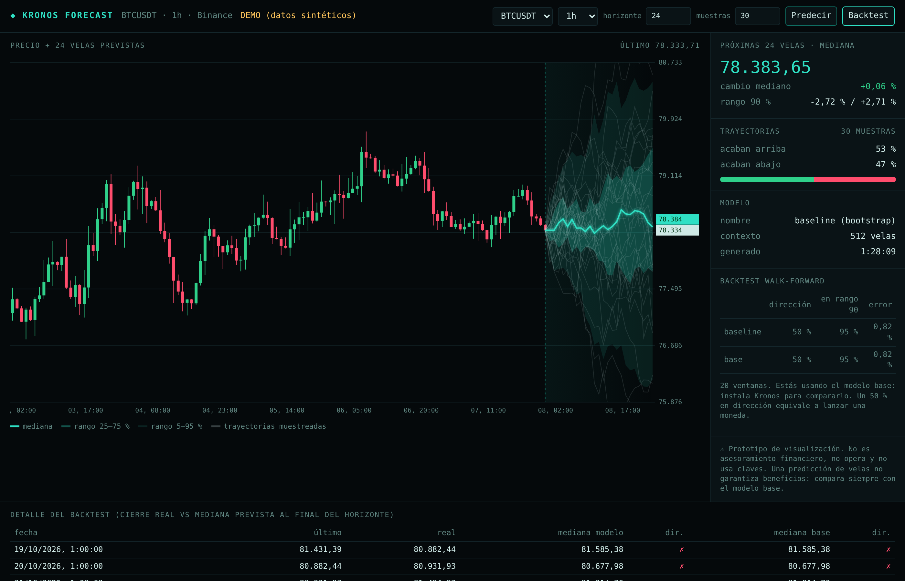

# Kronos Forecast — prototipo

Panel que descarga velas públicas de Binance y dibuja las **próximas N velas previstas** con
[Kronos](https://github.com/shiyu-coder/Kronos), un modelo abierto entrenado con velas.

**Solo sirve para visualizar.** No envía órdenes, no pide claves de API y no se conecta a ninguna cuenta.



## Qué muestra
- Velas reales y, a continuación, **30 trayectorias simuladas** con su mediana y los rangos 25–75 % y 5–95 %.
- El % de trayectorias que acaban por encima y por debajo del precio actual.
- **Backtest walk-forward**: en las últimas 20 ventanas, compara Kronos con un **modelo base**
  (bootstrap de retornos, sin tendencia). Mide el acierto de dirección, cuántas veces el precio real
  cayó dentro del rango del 90 % y el error. Si Kronos no supera al modelo base, no aporta nada.

## Cómo arrancarlo
```bash
cd prototipos/kronos-forecast
pip install numpy pandas
python server.py --demo        # datos sintéticos, para comprobar que todo funciona
python server.py               # datos reales de Binance (con el modelo base si Kronos no está instalado)
# abre http://localhost:8000
```

### Activar Kronos
```bash
git clone https://github.com/shiyu-coder/Kronos
pip install -r Kronos/requirements.txt
python server.py               # verás "[ok] Modelo cargado: Kronos-small"
```
- Los pesos se descargan solos de Hugging Face la primera vez (`NeoQuasar/Kronos-small` y `Kronos-Tokenizer-base`).
- `KRONOS_SIZE=mini|small|base` elige el tamaño del modelo y `KRONOS_DIR=/ruta` indica dónde clonaste el repositorio.
- En CPU, cada trayectoria tarda unos segundos: baja el número de «muestras» si va lento.
  El backtest con Kronos tarda varios minutos.
- Si `api.binance.com` está bloqueado en tu país, el panel prueba `data-api.binance.vision`.

## Archivos
- `server.py`: descarga de datos, modelos (Kronos y base), API (`/api/forecast`, `/api/backtest`) y servidor.
- `index.html`: el panel (canvas, sin dependencias).

> No es asesoramiento financiero. Predecir velas no garantiza beneficios.
